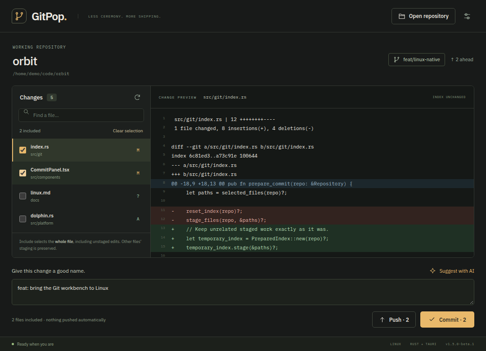
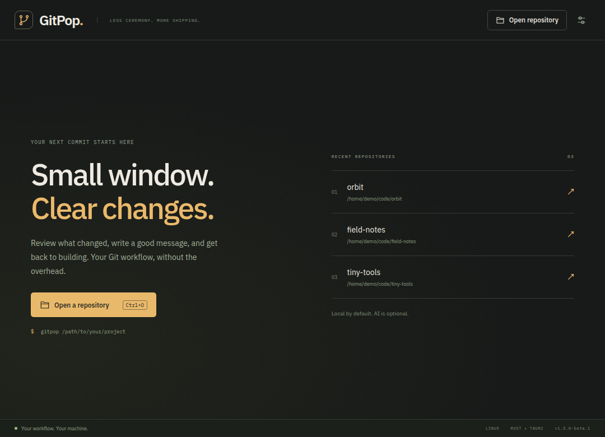

# GitPop

### Less ceremony. More shipping.

A focused Git workbench for reviewing changes, writing commits, and pushing when
you are ready. Built with Rust, Tauri 2, and React. AI is an optional assistant,
not a requirement for using your Git tools.

[Download preview](https://github.com/vinzify/gitpop/releases/tag/v1.5.0-beta.1) · [Contributing](CONTRIBUTING.md) · [Release checklist](docs/RELEASING.md) · [Report a problem](https://github.com/vinzify/gitpop/issues)



*Actual interface captured using fictional development fixtures. No private code,
credentials, or real repository paths are shown.*

> **1.5 preview:** Linux, Windows, and macOS packages are being validated for
> [v1.5.0-beta.1](https://github.com/vinzify/gitpop/releases/tag/v1.5.0-beta.1).
> Existing 1.4.x users must install this preview manually because updater signing
> has been rotated. The old stable channel is unchanged.

## Get GitPop

Choose a package from the [preview release](https://github.com/vinzify/gitpop/releases/tag/v1.5.0-beta.1):

| Platform | Package | Notes |
| --- | --- | --- |
| Linux x86_64 | `.deb`, `.rpm`, or `.AppImage` | Built on Ubuntu 22.04; optional KDE Dolphin integration |
| Windows x64 | Setup `.exe` or `.msi` | Choose one installer; optional Explorer context menu |
| macOS Apple Silicon | `aarch64` `.dmg` | Apple M-series Macs |
| macOS Intel | `x64` / `x86_64` `.dmg` | Intel Macs |

Verify the release's SHA256SUMS before installing. Updater signatures do not imply
Windows Authenticode signing or Apple notarization; see the release notes for
OS trust limitations. Do not install an unexpected or untrusted download.

### Your first commit

1. Open GitPop and choose **Open repository**, or run `gitpop /path/to/project`.
2. Review a changed file in the diff pane.
3. Include the whole files you want in this commit.
4. Write a message, or explicitly request an AI suggestion.
5. Click **Commit**. Use **Push** separately when you are ready.

## A small tool for the daily loop

- **Open any repository.** Use the native folder picker, recent repositories, or
  pass a folder on the command line. Subfolders resolve to their repository root.
- **Read before you commit.** A split file list and colour-coded diff keep the
  working tree visible. Search files without changing your selection.
- **Select deliberately.** Checkboxes include complete files, including unstaged
  edits. Nothing is preselected when opening a repository. This is not a hunk
  staging editor.
- **Keep other work intact.** Preview uses temporary index/object storage.
  Selected-file commits preserve unrelated staged changes. Failed Git commands
  surface errors instead of silently resetting staging.
- **Commit and push separately.** Write your own message or ask AI for a
  suggestion. No automatic AI calls, commits, or pushes. Publishing a branch
  explicitly sets its upstream on `origin`.
- **Stay oriented.** See your branch and locally known ahead/behind counts.
  Refresh is explicit; GitPop does not poll or scan your disk in the background.

## Desktop platforms

| Platform | Opening repositories | Optional context menu | Validation |
| --- | --- | --- | --- |
| Linux | Folder picker, recent repositories, CLI | KDE Dolphin, per-user | Native build and automated tests exercised locally; desktop smoke-check results below |
| Windows | Folder picker, recent repositories, CLI | Windows Explorer, per-user | Automated checks/builds in CI; native desktop interaction still needs field testing |
| macOS | Folder picker, recent repositories, CLI | Not included | Automated checks/builds in CI; native desktop interaction still needs field testing |

The native build uses each platform's system webview, not a bundled Chromium
runtime. This is a desktop application, not a terminal UI; Rust alone does not
guarantee a particular startup time or RAM footprint.

Dolphin integration is optional under Settings and applies only to the current
user. Keep the executable/AppImage in a stable location. Restart Dolphin if a new
menu is not immediately visible. Other Linux file-manager integrations are not
included yet.



## Run the preview from source

Install Git 2.31 or newer, a current stable Rust toolchain, Node.js 22, and your platform's
[Tauri prerequisites](https://v2.tauri.app/start/prerequisites/).

On Ubuntu/Debian-based development machines, the native dependencies include:

```sh
sudo apt-get update
sudo apt-get install libwebkit2gtk-4.1-dev build-essential curl wget file \
  libssl-dev libayatana-appindicator3-dev librsvg2-dev patchelf
```

Then:

```sh
git clone https://github.com/vinzify/gitpop.git
cd gitpop
npm ci
npm run tauri dev

# Open a particular repository in development:
npm run tauri dev -- /path/to/project

# Build an unsigned local preview, without updater signing artifacts:
npm run tauri build -- --no-bundle --config '{"bundle":{"createUpdaterArtifacts":false}}'

# Run the built Linux binary:
./src-tauri/target/release/gitpop /path/to/project
```

For a local Debian package, replace `--no-bundle` with `--bundles deb`.
Do not install an untrusted unsigned package. Public release signing and the
updater-key transition are tracked in [the release checklist](docs/RELEASING.md).

The CLI accepts an optional folder, `--help`, and `--version`. Without a folder,
it opens the current repository if one is available, otherwise the welcome screen.

## Optional AI suggestions

Configure your provider and model in Settings, include files, then click
**Suggest with AI**. Review the generated message before committing.

- **Ollama:** defaults to `http://localhost:11434`. Model discovery uses its HTTP API;
  the Ollama CLI does not need to be on GitPop's PATH.
- **LM Studio:** defaults to `http://localhost:1234/v1`. Start its local server,
  then use **Find models** or enter the model ID.
- **Cloud:** OpenAI, Anthropic, and Google Gemini retain their provider integrations.
  Enter the model ID from your provider rather than relying on a stale built-in list.
- **Compatible endpoints:** configure your own OpenAI-compatible base URL and model.

Only the selected diffs are submitted, and only when you request a suggestion.
Diffs can contain sensitive code or secrets: inspect your selection and endpoint
before using a cloud service. Local providers use the endpoint you configure;
pointing one at a remote server sends data there.

API keys entered in this preview are held **only for the current app session**,
not written to settings. Saving Settings removes a legacy plaintext key left by
older GitPop versions. OS-keychain persistence is not implemented yet. Non-secret
preferences and up to eight recent repository paths are stored locally.

## Controls and boundaries

- `Ctrl+O` / `⌘O`: open a repository.
- `Ctrl+R` / `⌘R`: refresh repository status.
- `Ctrl+Enter` / `⌘Enter`: commit included files with your message.
- Push is always a separate action. Ahead/behind counts reflect local tracking
  information; GitPop does not fetch automatically.
- Git uses your existing identity, hooks, credential helpers, SSH agent, and signing
  setup. GitPop does not manage hosting accounts or bypass repository protections.
- Merge conflicts and in-progress merge/rebase/cherry-pick/revert operations must
  be completed in Git before selected-file commits.
- Diff output is capped at 160 KB / 2,000 lines; previews of worktree files larger than 8 MiB
  are omitted. Commits still accept those files with a manually written message.
- Non-UTF-8 filenames are reported rather than silently corrupted. This preview
  does not implement partial/hunk staging, branch switching, pulling, or conflict resolution.

## Development and verification

```sh
npm test
npm run build
npx playwright install chromium
npm run test:e2e
cargo fmt --manifest-path src-tauri/Cargo.toml --check
cargo test --locked --manifest-path src-tauri/Cargo.toml
cargo clippy --locked --manifest-path src-tauri/Cargo.toml --all-targets -- -D warnings

# Regenerate documentation images with fictional data:
node scripts/capture.mjs
```

Browser tests mock Tauri IPC; they validate interface behaviour, not native OS
dialogs or real Git commands. Rust tests operate on disposable real repositories.
GitHub Actions checks the native code on Linux, Windows, and macOS.

Exact automated and native desktop validation for this preview is recorded in
[VALIDATION.md](docs/VALIDATION.md). Passing browser tests does not establish
support for every Linux desktop or distribution.

## License

[MIT](LICENSE). Contributions and focused bug reports are welcome.
